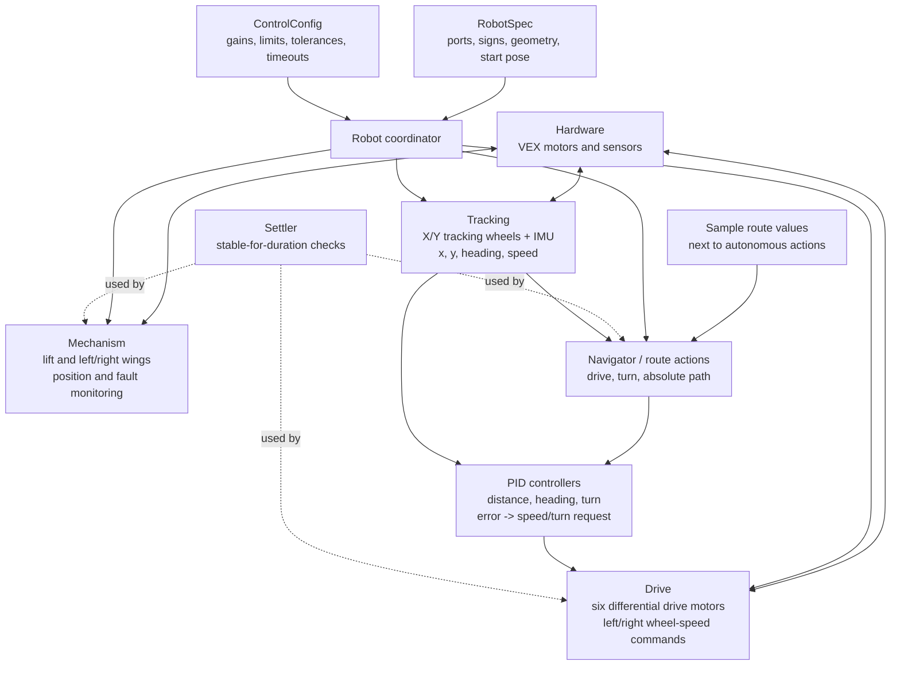
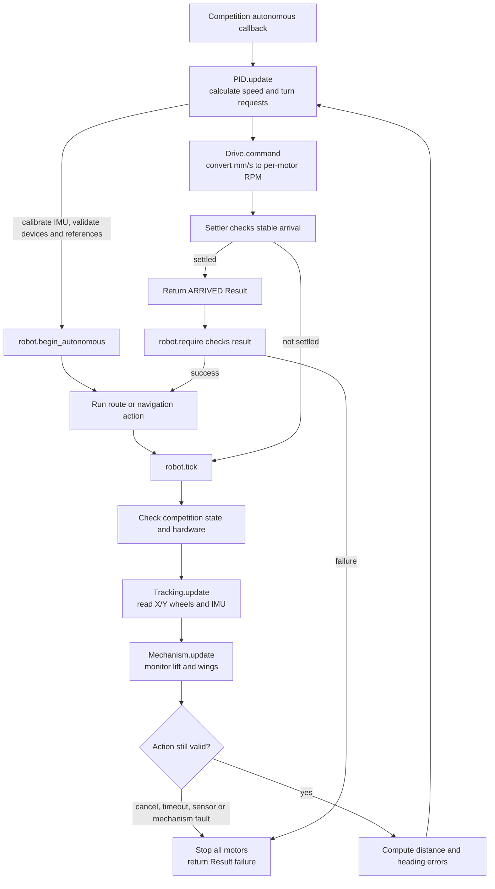

# H-base autonomous controller

`hbase.v5python` is the generated, deployable, self-contained Python source. The
original sample is preserved unchanged as `hbase_original.v5python`. The editable
source is split into `src/` fragments, but VEXcode still receives one file. No C++
files changed. Although the filename is `.v5python`, the supplied file contains
plain Python, not a packaged VEXcode project. Paste the generated contents into a
VEXcode Python project with the matching hardware setup; do not assume the extension
alone makes an importable project archive. Avoid creating duplicate device
definitions in the Devices-generated code. This source creates its own hardware in
`Hardware`.

## Edit and build workflow

The classes and route are separated into these development fragments:

```text
python/src/01_robot_spec.py   RobotSpec
python/src/02_control_config.py ControlConfig
python/src/13_route.py      run_route and its sample values
python/src/04_helpers.py      shared math helpers
python/src/05_results.py      Result and ActionFault
python/src/06_pid.py          PID
python/src/07_settler.py      Settler
python/src/08_hardware.py     Hardware
python/src/09_tracking.py     Tracking
python/src/10_drive.py        Drive
python/src/11_mechanism.py    Mechanism
python/src/11_navigation_path.py NavigationPath (ordered line geometry)
python/src/11_navigator.py    Navigator (field navigation controller)
python/src/12_robot.py        Robot
python/src/13_route.py        run_route
python/src/13_navigation_example.py run_navigation_example
python/src/14_main.py         main and competition callbacks
```

Edit those fragments, then build the VEX deployment file from the repository root:

```sh
python3 ./build_vex.py
python3 -m unittest discover -s ./tests -v
```

The builder concatenates fragments in dependency order. It does not create runtime
imports, so the Brain never needs sibling `.py` files or an SD card. Upload or paste
the resulting `python/hbase.v5python` into VEXcode. Do not edit the generated output
directly: the next build will replace it. If VEXcode modifies its generated device
boilerplate, keep one hardware definition and merge the source carefully rather than
creating duplicate `Brain`, motor, sensor or competition objects.

The fragments are intentionally deployment-oriented rather than normal desktop
Python packages: a fragment can refer to classes defined by an earlier fragment.
The generated file is the supported runtime artifact; host tests load that file.

## High-level architecture

The program has one `Robot` coordinator. It owns the hardware adapter, pose
tracking, chassis drive, mechanisms and navigation controller. Configuration is
kept separate from control logic so robot-specific measurements can be changed
without rewriting the controllers.



`Tracking` estimates the robot state; it does not command motors. `PID` converts
distance or heading error into a speed or turn request. `Drive` converts that
request into commands for the six chassis motors as two sides. `Mechanism`
commands attachments such as the lift and wings. `Settler` is a reusable
completion check used by motion and mechanism code; it does not control
hardware by itself.

## Autonomous workflow

The control loop is coordinated through `Robot.tick()`. This keeps tracking,
mechanism monitoring, cancellation and hardware checks alive while a drive,
turn or navigation action is running. Mechanism actions can therefore continue
while the chassis is moving.



At the end of every action, `robot.require(...)` decides whether the route may
continue. The final route wrapper stops all motors even when an action fails.

## What to edit

| Location in the program | Purpose |
| --- | --- |
| `RobotSpec` | Ports, reversals, wheel geometry, gearing, sensor signs, mechanism references, starting pose |
| `ControlConfig` | Gains, speed/acceleration limits, tolerances, settling times, timeouts |
| `run_route(robot)` | Sample route values, ordered autonomous actions and deliberate overlaps |
| `run_navigation_example(robot)` | Navigation sample values and ordered path action |
| `Hardware` | VEX API access and device construction |
| `Tracking`, `Drive`, `PID`, `Mechanism`, `Robot` | Reusable motion and action logic |
| `NavigationPath`, `Navigator` | Ordered waypoint geometry and field-coordinate movement |

The model is **two independently driven sides**, matching the original left/right
motor groups. The X sensor is a passive lateral tracking wheel, not a powered
strafe actuator. The confirmed layout has front/middle/back motors on each side,
with 600 RPM front/back and 200 RPM middle configurations. Left and right have
the same arrangement. External gearing remains a required measurement; navigation
uses the existing per-motor RPM conversion and common saturation. RPM is a speed
rating, not a motor wattage specification. All six drive motors, both lift motors,
both wing motors, the claw,
X/Y rotation sensors, IMU, and original driver controls remain represented.
The route deploys only the right wing, as in the original; driver R2 drives both.

## Required measurements before driving

`None` values are intentionally required measurements. Startup reports all missing
measurements and does not enable driving. Replace them; do not substitute guessed
zeros for unmeasured offsets. This readiness requirement applies to driver mode
too, since it shares the calibrated per-motor speed conversion.

1. **Tracking wheel diameters**: fill `TRACK_X_DIAMETER_MM` and
   `TRACK_Y_DIAMETER_MM`. Use effective rolling diameters under robot load.
   Set sensor turns per wheel turn to 1 only for direct coupling. The conversion is
   `sensor_degrees / 360 * pi * diameter / sensor_turns_per_wheel_turn`.
2. **Signs**: push the robot forward without turning: corrected Y must increase.
   Push it right: corrected X must increase. Turn clockwise: corrected IMU rotation
   must increase. Change the three `*_SIGN` parameters when needed. These tracking
   signs apply after the configured sensor reversal (currently both False).
3. **Tracking offsets**: the two `TRACK_*_ROTATION_MM_PER_RAD` parameters describe
   signed travel generated by rotation alone. Rotate around the tracking reference
   center without translation and calculate:
   `offset = signed_tracking_travel_mm / signed_IMU_rotation_radians`.
   Use several clockwise/counterclockwise trials. X offset is positive for a
   transverse wheel ahead of center; Y offset is negative for a longitudinal wheel
   to the right of center. After calibration, a pure turn should leave estimated
   X/Y nearly unchanged. These signs assume the documented +X right / +Y forward
   convention and perpendicular tracking wheels.
4. **Drive geometry**: fill six `DRIVE_WHEEL_DIAMETERS_MM` values and six
   `DRIVE_MOTOR_TURNS_PER_WHEEL_TURN` values, ordered left front/mid/back then right
   front/mid/back. Ratios are external transmission ratios only, excluding the
   internal 6:1/18:1 cartridge. A 1:1 motor-output-to-wheel connection means 1.0.
   The controller calculates motor RPM separately for each wheel. It scales all
   targets together when any motor or configured wheel-speed limit is reached.
   Do not assume the original mixed cartridges have matching external gearing.
5. **Mechanism references**: manually place both lift sides and both wings at
   known positions before starting the program, then set `LIFT_REFERENCE_DEG` and
   `WING_REFERENCE_DEG` accordingly. Prefer a common aligned zero for paired lift
   motors. There are no homing switches in the configured hardware, so software
   cannot independently find the physical home. Encoder zero assignment does not
   move the mechanism. Verify claw polarity and motor reversals.
6. **Starting pose**: place the robot on repeatable marks matching `START_X_MM`,
   `START_Y_MM`, and `START_HEADING_DEG` before every autonomous run. Calibration
   occurs stationary at startup; the pose/sensor baselines are captured at actual
   autonomous start. Tracking encoders are not reset between route actions.

Use the Brain Devices screen / VEXcode sensor monitor to obtain raw sensor values
while measuring. The motors do not need to run to measure passive tracking travel.
For straight-line calibration, compare a long measured push with converted sensor
travel. Correct effective diameter by `old_diameter * actual_distance / reported_distance`.

## Motion API and feedback

```python
robot.require(robot.drive_distance(
    distance_mm=600, heading_deg=0, max_speed_mm_s=300, timeout_ms=5000
), "travel to pickup")

robot.require(robot.turn_to_heading(target_deg=90, timeout_ms=4000), "face goal")

robot.lift.start(target_deg=300, speed_pct=70)
# A drive action may run here while the lift moves.
robot.require(robot.wait_for(robot.lift), "lift ready")
robot.set_claw(False)
```

`drive_distance` uses signed distance: negative means reverse while retaining the
specified chassis heading. Each call starts a line at the current measured pose,
in the direction of `heading_deg`; it does not navigate to an absolute field point.
Turn to approximately that heading before a long drive.

Both tracking wheels and continuous IMU rotation feed the pose estimate. Tracking
offset compensation removes movement caused by rotation. X measures lateral
displacement, which steers the differential base toward the line. The steering sign
reverses for backward travel. This is modest line correction, not holonomic movement
or a full path planner. Large displacement returns `PATH_ERROR`; a large residual
lateral error close to the endpoint may time out because recovery would require a
new maneuver. A new segment starts at the measured endpoint and therefore does not
erase accumulated global position error.

Distance PD, heading PD, and turn PD use measured seconds and filtered measurement
derivatives. PID integral support is available but unused by the initial tuning.
Acceleration/deceleration and turn-command slew limits reduce abrupt demands.
Outputs are physical wheel-speed requests translated to individual motor RPM;
the motor API handles velocity regulation. No X-drive wheel mixer or voltage PID
gains are copied. A 20 ms wait is a nominal cadence, not a guaranteed fixed period.

Arrival requires position, heading and measured-speed conditions to remain within
tolerance for a settling interval. Every motion has a timeout, progress checks,
sensor-plausibility checks and competition cancellation. Mechanism jobs also have
deadlines, encoder-based completion, and paired-lift skew checks. All waits service
the same coordinator; there are no competing autonomous threads writing motors.

Results: `ARRIVED`, `TIMED_OUT`, `STALLED`, `CANCELLED`, `SENSOR_FAULT`, `PATH_ERROR`,
`NOT_READY`, `MECHANISM_FAULT`. `robot.require(...)` aborts the route on failure.
Motion failures cancel pending mechanism jobs; the route wrapper always stops all
motors. Mechanisms stop with HOLD, drive motors with BRAKE. The claw retains its
last commanded state on failure. A stall is not interpreted as successful contact.

Device `installed()` checks are used where the runtime exposes them. Not every VEX
Python release documents that method for every motor/sensor. Progress and plausibility
checks remain active, but a frozen X sensor while driving perfectly straight cannot
be proven healthy from its unchanged value alone. Check device presence and signs
physically before testing. No software-only feedback eliminates tracking-wheel slip,
IMU drift, incorrect starting placement or bad geometry calibration.

## Phase 5: absolute positions and ordered paths

Phase 5 uses the existing X/Y tracking wheels and IMU only. The field pose persists
between actions. Unlike `drive_distance`, `go_to_pose` targets an absolute coordinate,
so a measured error in an earlier leg is included when computing the next movement.
The mechanism jobs, competition cancellation and total route deadline still run
through `Robot.tick()` during navigation. No extra control thread is created.

```python
# Absolute field position in millimeters; turn to 90 degrees AFTER reaching it.
robot.require(robot.go_to_pose(
    x_mm=300, y_mm=600, heading_deg=90,
    max_speed_mm_s=250, timeout_ms=10000,
), "reach scoring pose")

# Back toward a coordinate with the rear of the robot leading.
robot.require(robot.go_to_pose(
    x_mm=300, y_mm=200, heading_deg=0,
    max_speed_mm_s=200, reverse=True, timeout_ms=10000,
), "retreat to field coordinate")

# Ordered polyline; the current measured position is prepended automatically.
robot.require(robot.follow_path(
    [(0, 400), (300, 600), (300, 900)],
    final_heading_deg=0, max_speed_mm_s=250, timeout_ms=12000,
), "follow route")
```

The examples are independent API examples, not a ready-to-run sequence for your
field. All coordinates share the frame set by `RobotSpec.START_*`: +X right, +Y
forward at heading zero, clockwise headings. They are NOT coordinates relative to
each new call. `heading_deg=None` / `final_heading_deg=None` means stop without a
separate requested final rotation. `reverse=True` applies to the entire call;
split the path into separate calls to change travel direction.

For an isolated chassis test, set `AUTONOMOUS_ROUTE` in
`python/src/14_main.py` to `"navigation_example"`. Edit the points, final
heading, speed and timeout at the top of `run_navigation_example`, build, then
run autonomous from the marked starting pose. The default remains `"sample"`,
which runs the original task sequence with
the phase 1–4 primitives. The example does not operate the claw/lift/wings.

### How following and arrival work

`NavigationPath` keeps the waypoint order. It projects the robot onto the active
line segment and selects a target up to `NAV_LOOKAHEAD_MM` farther along that
segment. `Navigator` turns toward this point with heading PD while controlling
forward or backward speed. This is differential lookahead steering, not the
X-drive PurePursuit implementation or a curvature-based differential Pure Pursuit
formula. It uses the calibrated wheel-speed mapping without needing an additional
track-width parameter.

Intermediate points are accepted inside `NAV_WAYPOINT_RADIUS_MM` (35 mm by default).
They are connected by straight segments, not Bézier control points. Corners can be
rounded within that acceptance radius; use separate `go_to_pose` calls for required
stops. Only the active waypoint may advance: being close to the final point of a
loop or to a later crossing cannot skip the rest of the path. Consecutive duplicate
points are collapsed. A nonempty path whose points all equal the starting position
still performs the requested final turn and settling checks.

Speed decreases near the remaining route endpoint and when steering error grows.
Above `NAV_ALIGN_DEG`, translation decelerates to zero while the robot reorients.
Forward/reverse is explicit; it never silently switches travel direction. An
overshoot can require turning around to approach again. There is no collision
avoidance: every planned segment and potential turning maneuver needs clearance.

Arrival requires the last segment, position error at most `NAV_POSITION_TOL_MM`
(15 mm), requested final-heading tolerance, low measured translation/rotation,
and a continuous settling interval. The final heading is not held throughout the
path: a differential base must turn to steer. Position continues to be checked
during final rotation; if it leaves the arrival region, the controller approaches
the endpoint again within the same deadline.

### Bounded recovery and failures

Moderate deviations are corrected by normal steering. If distance to the active
segment exceeds `NAV_RECOVERY_CROSS_MM` (100 mm), the controller temporarily aims
at the closest point on that segment at at most `NAV_RECOVERY_SPEED_MM_S` (120 mm/s).
It returns to following below half that cross-track threshold. It does not reset
the pose estimate, skip waypoints or guess that a collision has established a new
known position.

Recovery is bounded by `NAV_RECOVERY_TIMEOUT_MS` (2000 ms) and
`NAV_RECOVERY_ATTEMPTS` (2). Exceeding `NAV_MAX_CROSS_MM` (300 mm), a recovery timeout,
or the attempt count returns `PATH_ERROR`. A blocked drive/turn or a lack of useful
progress returns `STALLED`. Every call has a single overall timeout covering path
travel, reorientation, recovery and final settling. The existing whole-route
deadline also applies, even when a call requests a longer timeout. Invalid arguments
stop outstanding work and raise `ValueError`; runtime motion failures return `Result`
and stop drive and mechanism motors. Use `robot.require(...)` to prevent subsequent
route actions after a failure.

Console telemetry identifies the active segment, travel/align/finish state and
rejoin attempts, as well as field pose, endpoint distance and segment deviation.
An X encoder that reports an actual sideways disturbance can drive a correction;
an X encoder that slips or silently freezes cannot supply that information. Without
external measurements the robot cannot discover all pose drift or correct shifted
starting placement. Do not add wheel- or side-speed trim values merely because the
motor cartridges differ: calibrate the mechanical ratios first and use measured
errors to justify additional tuning.

### Phase 5 field tests

After phase 1–4 calibration, test one goal at low speed in each direction, reverse
travel, repeated absolute goals, a corner, and a closed route. Check physical
endpoint position after final rotation. Repeat with load/battery/surface changes
and small controlled lateral disturbances; measure accumulated drift externally.
Test a blocked drive, disabled competition, and failed mechanism while navigating.
Tune the `NAV_*` constants in `ControlConfig` to actual clearances and response.
Host tests cover the control logic with a simple simulated plant; they cannot
establish real-field positional accuracy or choose the physical calibration values.

## Intentional changes to the sample route

- `turn_head(90, 1, 55)` now really completes a 90-degree turn within configured
  tolerances. The original allowed a 55-degree heading error. Recheck the route
  geometry; this is a significant behavior change.
- The original `Drive_forward(5, 50, 500)` now requires its distance to complete,
  using the normal action timeout. It is not silently treated as a timed push.
  If that action was intended to press into an object, implement an explicit bounded
  contact action with its own completion criteria after confirming that intent.
- Legacy route units are converted using `0.31 * pi * Y_diameter / sensor_ratio`.
  Thus the old encoder-distance scale is preserved without inventing inches or cm.
  Replace the route expressions with measured millimeters when the field route is
  surveyed. Percentages in the new route scale the configured maximum **wheel
  speed**, not the old mixed-cartridge motor percentages.
- Lift moves are absolute: 300 carry, 100 release, 150 clear, 300 carry. Right wing
  deploy is absolute 300. There is no accumulated relative-angle drift on reruns.
- Releasing the claw waits for the lift to settle. Concurrent lift/wing motion is
  still allowed, but it is monitored during driving and pauses.
- R1 toggling lives inside driver mode, so no old claw thread survives to issue
  autonomous commands. Original arcade axes, lift buttons and wing button remain.
- Total autonomous budget defaults to 15000 ms. Budget exhaustion aborts the route.
  Verify the full route finishes under the actual event limit; do not extend the
  budget just to hide a slow or stalled route.

## Field calibration and acceptance

Tune in this order: geometry/signs, low-speed straight driving, heading hold,
stopping behavior, turns, X-based line correction, mechanisms, then the full route.
Begin with the configured conservative speeds and adjust from measured performance.
Do not copy C++ gains: their units, timing and drivetrain mapping differ.

For each condition, run at least ten trials and record externally measured final
position and angle, elapsed time, result status, battery level, load and surface.
Use console `drive`/`turn` records to compare the internal estimate, not as ground
truth. Test forward/reverse, short/long travel, clockwise/counterclockwise turns,
359/0-degree crossing, modest lateral disturbances, payload changes and different
battery/surface conditions with gains held fixed. Test blocked movement, disconnects,
disable/mode changes and a mechanism that cannot reach its target.

Set acceptable errors from actual pickup/scoring clearance. The configured 10 mm
along-line, 15 mm lateral and 2-degree heading thresholds are controller criteria,
not measured real-world accuracy claims. Inspect worst-case error and failure rate.

## Host validation

From the repository root:

```sh
python3 -m unittest discover -s python/tests -v
```

Tests load the same deployable source with a small fake VEX module. A deterministic
differential-drive plant exercises forward/reverse, heading wrap, unequal drive
response, loop jitter, X disturbances, pure-turn offset compensation, saturation,
stall/timeout/cancellation, mechanism skew/timeout, route abort and route completion.
It does not emulate firmware scheduling, motor friction, real traction, sensor noise
or the VEX Python interpreter. VEXcode download and physical tuning are still needed.

API references used for the runtime calls:
- [VEX motor and motor group API](https://api.vex.com/v5/home/python/Motion/motor_and_motor_group.html)
- [VEX inertial API](https://api.vex.com/v5/home/python/Inertial.html)
- [VEX Timer API](https://api.vex.com/v5/home/python/Logic/Timer.html)
- [VEX competition API](https://api.vex.com/v5/home/python/Competition.html)
